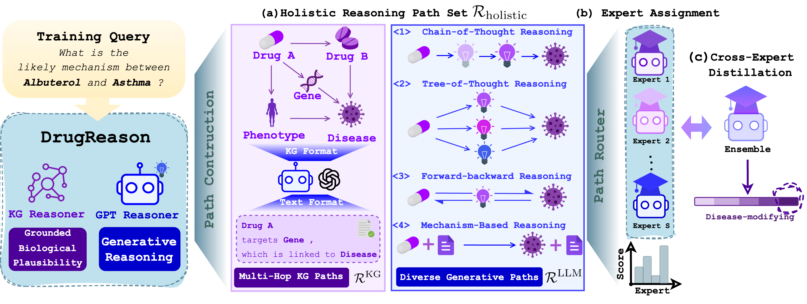

# DrugReason

Implementation for **DrugReason: Dynamic Multi-View Reasoning over Knowledge Graph and Language Evidence for Drug Repurposing**.

**Accepted at EMNLP 2026 (Main Conference).**

DrugReason combines KG evidence and label-free teacher reasoning views, routes each view to a Llama or Qwen expert, and trains the experts with symmetric mutual distillation over a shared semantic label space.



## Install

Use Python 3.11 or newer with a CUDA-enabled PyTorch installation:

```bash
pip install -e '.[teacher]'
```

The default experts are `meta-llama/Llama-3.2-3B-Instruct` and `Qwen/Qwen2.5-3B-Instruct`, loaded in 4-bit precision with LoRA adapters. A frozen RoBERTa encoder supplies routing representations. Access to the base models is required. Use `--quantization none` to disable quantization.

## Prepare data

Original datasets: [DDInter](https://huggingface.co/datasets/Tassy24/K-Paths-inductive-reasoning-ddinter), [DrugBank](https://huggingface.co/datasets/Tassy24/K-Paths-inductive-reasoning-drugbank), and [PharmacotherapyDB](https://huggingface.co/datasets/Tassy24/K-Paths-inductive-reasoning-pharmaDB).

```bash
python -m drugreason.data --dataset ddinter --output data/ddinter
```

This creates training and test pairs with entity definitions and individual KG-path views, plus `labels.json`. Use `drugbank` or `pharmaDB` for the other datasets. The canonical label spaces contain 4, 86, and 3 labels respectively. DrugBank verbalizers preserve relation direction using the fixed roles “drug A” and “drug B”.

The defaults retain up to 2,000 training pairs and 1,000 test pairs, and up to four paths per pair. Test subsampling uses seed 42. Limits and path counts are configurable.

## Construct training views

Configure `OPENAI_API_KEY` and, if needed, `OPENAI_BASE_URL`, then generate the four teacher strategies:

```bash
python -m drugreason.generate \
  --input data/ddinter/train.jsonl --output data/ddinter/train_views.jsonl \
  --model YOUR_TEACHER_MODEL
```

This step makes teacher API calls and can resume completed pairs. Azure deployments use `AZURE_OPENAI_ENDPOINT`, `AZURE_OPENAI_API_KEY`, and `AZURE_OPENAI_API_VERSION`.

Teacher prompts contain the candidate entities and reasoning instructions, without gold labels. Deterministic filtering rejects empty or malformed responses and removes explicit answer fields without paraphrasing retained text. Generated views are used only during training; inference uses KG views and never calls the teacher.

**Reasoning dataset:** [JesseLiu/DrugReason-Reasoning](https://huggingface.co/datasets/JesseLiu/DrugReason-Reasoning) provides 20,544 label-conditioned annotations for 5,136 entity pairs, including full reasoning text and training prefixes. The training protocol above requires label-free views generated with `drugreason.generate`; the released annotations are not compatible with that input requirement.

## Train

Stage 1 trains the router and experts with routed label-generation loss and entropy regularization of the average routing load:

```bash
python -m drugreason.train --stage router --dataset ddinter \
  --data data/ddinter/train_views.jsonl --labels data/ddinter/labels.json \
  --output outputs/router
```

Stage 2 continues routed supervision and adds symmetric label-space KL distillation:

```bash
python -m drugreason.train --stage mutual --dataset ddinter \
  --data data/ddinter/train_views.jsonl --labels data/ddinter/labels.json \
  --checkpoint outputs/router --output outputs/mutual
```

Each expert scores every token of each canonical verbalizer and normalizes by its length. Distillation compares distributions over the same ordered labels, with detached teacher targets and the temperature-squared scaling factor. Different expert tokenizers therefore share label semantics without comparing vocabulary indices. The router remains trainable in both stages.

The objectives are:

```text
Stage 1: routed label-generation loss − λ₁ × routing-load entropy
Stage 2: Stage 1 + λ₂ × symmetric label-distribution KL
```

Dataset-specific learning rates and coefficients follow the paper's appendix. The defaults use one epoch, length 768, and an effective batch of eight pairs through gradient accumulation. Every available view contributes. `--learning-rate`, `--router-learning-rate`, `--load-weight`, `--mutual-weight`, `--temperature`, and `--tau` override the settings. `--label-batch-size` controls scoring memory use. Full label-space scoring, especially for DrugBank, is more expensive than scoring only the gold label.

## Evaluate

```bash
python -m drugreason.evaluate --checkpoint outputs/mutual \
  --data data/ddinter/test.jsonl --output outputs/predictions.jsonl
```

Inference uses deterministic router assignments, evaluates only the selected expert for each KG view, and averages the view-level label distributions. The output contains predictions, label probabilities, and routes. Label accuracy is printed when reference labels are available.

## Code

- `data.py`, `prompts.py`, `generate.py`: evidence preparation and label-free teacher views.
- `components.py`, `losses.py`: routing, full-verbalizer scoring, and training objectives.
- `train.py`, `checkpoint.py`, `evaluate.py`: training, checkpoints, and routed inference.
- `scripts/export_reasoning.py`: reasoning annotation export.

## Tests

```bash
python -m unittest discover -s tests -v
```
